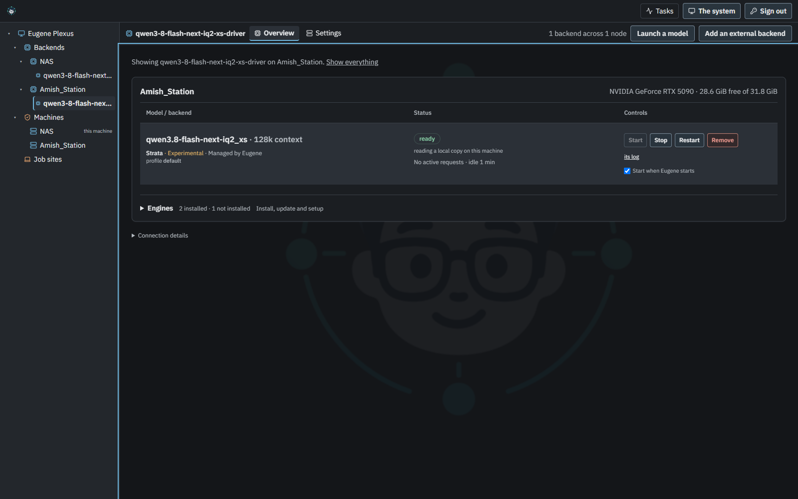
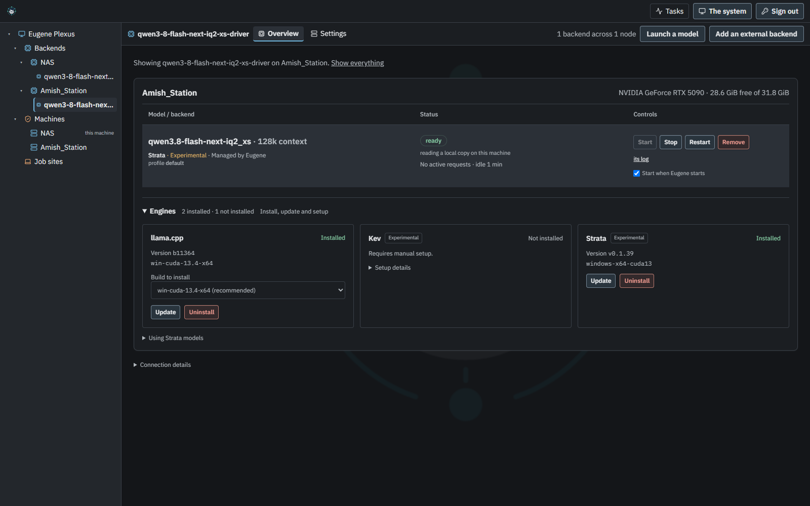

# Engine overview redesign acceptance

2026-10-15. Implements the [engine overview layout](../design/engine-overview-layout.md)
requested after Troy's screenshot. No backend, protocol or dependency changes.

## Published sources

- UI redesign: `1875972111604034186d63818a13a64018bfe2ff`.
- Final UI source, including archive version stamping and portable regression checks:
  `97dfcbdec4e2d3c041dbd0de8cb82363c182970c`.
- UI distribution: `9cd994091c5ec9a2ecc191b8c7593c4b878b9019`.
- `release/manifest.json` and both generated installers name that distribution.
  Other component pins and the dependency lock are unchanged.

## Product evidence

The built Next.js export was served on an OS-selected loopback port and driven
in system Chrome on Windows. Disposable NAS/Amish_Station API responses reproduce
the long QWen name, RTX 5090 budget, installed llama.cpp and Strata engines, and
lengthy manual Kev instructions in the supplied screenshot. These are browser
fixtures, not calls to the user's running machines or models.

Additional [phone](engines-page-data/engines-mobile.png) and
[light-theme](engines-page-data/engines-light.png) screenshots are retained with
the [counted browser result](engines-page-data/browser.json).

`scripts/engines-browser-acceptance.mjs` verified:

- Models precede engine management. Manual commands and Strata notes are hidden
  until disclosed; keyboard Enter opens engine management and setup remains
  accessible. Repeated model/runtime identity is absent.
- No horizontal scrolling in the page, model cells, disclosures or build selectors
  at 1600, 1280, 768, 390 and 320 pixels. Long external model names and multiple
  machines also fit. Removal confirmation fits at phone width.
- Start, Stop, autostart and Restart use the selected worker's proxy. Restart's
  fixture refusal is displayed. Removal focuses Keep, Escape cancels, and no
  DELETE occurs. The log link retains the worker identity.
- Choosing the CPU build sends `{variant: "win-cpu-x64"}` to that worker.
  Existing install progress opens Engines after reload; a subsequent checksum
  failure remains visible. Inventory failure leaves model controls available.

The fixture counted exactly five writes: Stop, Start, autostart, Restart and
the selected build installation. No browser page errors occurred. All operations
were intercepted; no live inference process or installed engine was changed.

## Checks and review

All **2,070 tests in 163 files** passed. The affected page/component/join suite
passed 70 tests. The final duplicate-name test refinement also passed in the
50-test unmodified sabotage control. TypeScript, ESLint, Prettier, the production
build, source whitespace checks and staged secret scans passed.

Four temporary-copy mutations were caught: initially expanded engine management,
initially exposed manual setup, suppressed automatic expansion for an install
failure, and restored duplicate model identity. The source fingerprint was
unchanged. CI now runs these checks and the Chrome acceptance.

Adversarial review checked that disclosure did not hide failures, remove engine
build choices, lose uninstall confirmation, or send worker actions to the local
agent. Existing declined/removal and autostart behavior stayed covered by the
page tests. Healthy connection details moved out of the primary view; warnings
retain their visible placement.

Package verification found that the old distribution carried its version-stamp
`.gitattributes` rule only on `dist`. It is now in `main`, so rebuilding from
source preserves the installed commit identity. The final distribution differs
from source only by BUILD_INFO and 265 built files. BUILD_INFO records
`installer-ref: main`; this is a main/Edge build, not a new stable release tag.

The exact published archive matched both changed product modules and every
asset from the Chrome-tested export. A wheel built from that archive imported
under Python 3.12, reported the correct distribution commit, and retained all
265 assets byte for byte. Wheel SHA-256:
`cd736817630ec1a56357518628e821d61e28d9fcbd8ca0a91bcb00487fd03961`.

Installer regeneration and freshness checks passed. The release-artifact check
also verified exact Git bytes, checksums and agreement of all seven component
pins, and caught deliberate platform-pin divergence.

The first CI pass completed lint, typing and the full test suite, then failed
in the sabotage result parser because ANSI colors interrupted its expected
assertion text. The checker now strips terminal control codes; its unmodified
control and all four mutations passed with forced colored output. The product
assets were unchanged, and the final package was verified again.

[Final UI CI](https://github.com/eugene-plexus/ui/actions/runs/38833294022) was running
at publication. Browser measurements are Chrome on Windows with fixture APIs;
they do not claim live engine-install, Safari or Firefox acceptance. The running
NAS/worker installation was not upgraded.
